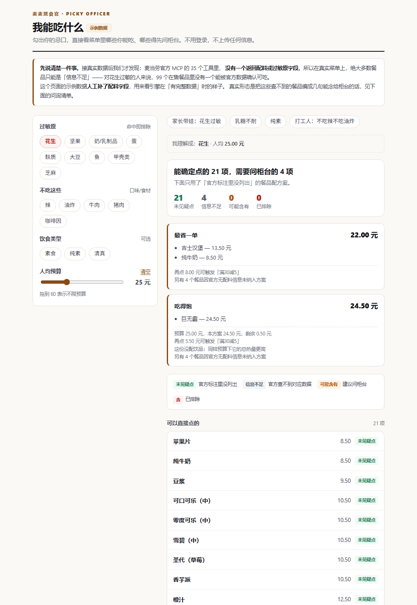

# 麦麦挑食官 · mcd-picky-officer

> 先确认你能吃什么，再谈吃什么。

**勾出你的忌口，直接看菜单里哪些你能吃、哪些必须问柜台。** 不用登录，不上传任何信息。

<p>


</p>

```bash
python run.py demo        # 在浏览器里打开交互演示，不用 Token
```



---

## 为什么做这个

我有个朋友花生过敏。每次一起吃麦当劳，她要做的事是：把手机举到柜台前，一条一条问「这个含花生吗」。

问到最后她通常就点一个最保险的东西，然后吃得不太开心。

**省钱工具遍地都是，帮人确认「我能不能吃」的一个都没有。**
这场比赛进榜的 100 个项目里，做券的、做预算的、做热量的、做人格测试的都有——没有一个是做忌口筛选的。

所以我做了这个。然后接上官方接口，拿到了一个我自己都不太想承认的结果。

---

## 接了真实接口之后，发现了这样一件事

麦当劳官方 MCP 一共 **35 个工具**。我逐个探过：

| 接口 | 它到底给什么 |
|---|---|
| `query-meals` | 菜名、现价、原价、图片、标签。**没有配料** |
| `query-meal-detail` | 套餐结构、可选加料、差价。**没有配料** |
| `list-nutrition-foods` | 160 行精确营养值：热量、蛋白、脂肪、碳水、钠、钙。**没有配料** |

`list-nutrition-foods` 里有一列叫 `nutritionDescription`，看起来正是放配料描述的地方——**160 行全是 `null`**。

于是真实场景长这样（北京建外 SOHO 店，2026-10-22 实测，99 个在售餐品）：

```
我理解成：过敏[花生]、不吃[辣]、人均[35.00 元]

已排除（明确不符合你的要求）：13 项
  - 龙焰鸡腿堡       15.90 元   辣度标记为 2/3
  - 麦辣鸡腿汉堡      22.50 元   辣度标记为 2/3
可能含有 / 踩线（建议问柜台）：0 项
信息不足（官方查不到对应数据）：86 项
  - 牛肉堡单品精选     14.00 元   官方未提供配料信息，无法确认是否含花生
  - 麦乐鸡           14.00 元   官方未提供配料信息，无法确认是否含花生
未见疑点：0 项
```

**对花生过敏的人，99 个餐品里没有一个能被官方数据确认可吃。**

这就是这个产品存在的理由，也是它不打算掩饰的东西。

但它不能只输出一句「你什么都别吃」。所以它把这些查不到的餐品，编译成了几句能直接念给柜台的话：

```
去柜台时念这几句
────────────────────────────────────────────────────────
先问（对所有餐品都成立，也最容易被漏掉）：
  · 和含花生的餐品共用同一个炸锅或操作台吗

再按这几句问（覆盖 86 个官方查不到数据的餐品）：
  · 配料里有花生、花生油或花生酱吗？
  · 做的时候放了辣椒、辣酱或辣味粉吗？
    ↳ 适用于：牛肉堡单品精选、麦乐鸡、薄皮焦香V翅、麦香鸡 … 等 86 项
```

第 1 句是任何接口都查不到、但严重过敏最常出事的地方。它排在具体餐品问题之前，不是随手加的。

**这就是我朋友原本在柜台做的事——现在话是现成的。**

---

## 它确实能做准的部分：营养筛选

配料查不到，营养是真的。官方 160 行数据是精确值，所以控钠、控热量、高蛋白这类需求可以做硬约束：

```
$ python run.py ask "控钠，人均35" --online --city 北京市 --keyword 国贸

已排除（明确不符合你的要求）：10 项
  - 麦香鸡       17.00 元   钠 731mg，超过上限 600mg
  - 麦辣鸡腿汉堡   22.50 元   钠 1208mg，超过上限 600mg
  - 板烧鸡腿堡    23.50 元   钠 1041mg，超过上限 600mg
可能含有 / 踩线（建议问柜台）：2 项
  - 薄皮焦香V翅   16.00 元   钠 594mg，接近上限 600mg
  - 麦香鱼       22.50 元   钠 556mg，接近上限 600mg
信息不足（官方查不到对应数据）：82 项
  - 麦乐鸡       14.00 元   官方营养表没有这个餐品，无法核对钠含量
```

注意「信息不足」占了 82 项——菜单 99 个餐品，按名称**精确**命中营养表的只有 19 个（19%）。

菜单里满是「麦辣鸡腿汉堡三件套」，营养表里是「麦辣鸡腿汉堡」。**套餐的热量不是单品热量**，所以 `nutrition.lookup()` 只做精确匹配，不做模糊匹配：宁可判「查不到」，也不拿单品的数字冒充套餐的。

---

## 核心设计：四种状态，一种诚实

大多数「饮食助手」把菜单分成两类：**能吃 / 不能吃**。但对过敏的人来说，这个二分法是有害的——因为「不知道」被默认归进了「能吃」。

我们给四种结论，并且**把「不知道」单独拎出来**：

| 判定 | 含义 | 是否进方案 |
|---|---|---|
| **含** | 官方标注、名称或描述中明确出现 | 绝不 |
| **可能含有** | 名称里有相关线索（如「芝士」对奶、「裹粉」对蛋） | 默认不进，需你显式同意 |
| **信息不足** | 官方查不到对应数据，无从判断 | **默认也不进** |
| 未见疑点 | 官方标注里没列出，且数值满足你的约束 | 可以 |

关键在第 3 行。**没有数据不等于安全。** 这条线写在代码里而不是文档里：

```python
@property
def allowed(self) -> bool:
    return self.verdict == Verdict.CLEAR      # 只有 CLEAR 才放行
```

`NO_INFO` 和 `CLEAR` 被分开处理，是这东西敢用在真过敏的人身上的前提。

---

## 快速开始

零第三方依赖，Python 3.11+ 即可。不需要 Token 就能跑完整流程。

```bash
# 在项目根目录
python run.py demo                                    # 打开交互演示页
python run.py ask "我花生过敏，不吃辣，人均25"           # 终端里出清单
```

接真实的麦当劳 MCP 数据：

```bash
export MCD_MCP_TOKEN="你的 Token"      # PowerShell: $env:MCD_MCP_TOKEN="..."
python run.py doctor                   # 先体检：工具名 / 字段 / 参数 / 红黄绿灯
python run.py ask "花生过敏，人均35" --online --city 北京市 --keyword 国贸
```

生成一张可以直接发群里的清单卡（含问询清单）：

```bash
python run.py ask "我乳糖不耐，不吃油炸，人均30" --online --html card.html
```

### `doctor`：接真实数据前必跑

接接口最容易踩的坑不是写错代码，是**猜错工具名和字段**。`doctor` 用零副作用的方式把真相问出来——而且它不是只调 `tools/list`，它自己走完一条只读探测链：

```
query-nearby-stores → storeCode → query-meals → query-meal-detail → list-nutrition-foods
```

因为 `query-meals` 的必填参数就是 `storeCode`，不先查门店连菜单都调不了。

输出是三档结论（本次实测 **黄灯**：有营养、无配料），并把这个结果存成 `docs/mcp-tools.json` 作为证据。

**它内置写动词拦截，实测 35 个工具里拦掉 7 个**：`create-order`、`cancel-order`、`mall-create-order`、`party-order-create`、`delivery-create-address`、`auto-bind-coupons`（会自动往账户里领券）、`draw-lottery`。这套名单有专门测试守着，包括一条反向用例：`query-order`、`order-list` 这类只读工具不能被误杀。

### 跑测试

```bash
python -m unittest discover -s tests -t .
# Ran 206 tests ... OK
```

全部 206 个测试不依赖网络、不需要 Token。

---

## 能力清单

| 能力 | 说明 |
|---|---|
| 中文口语解析 | 「花生过敏」「乳糖不耐」「不吃辣」「纯素」「控钠」「人均25」→ 结构化档案 |
| 9 类过敏原 | 花生、坚果、奶、蛋、麸质、大豆、鱼、甲壳类、芝麻 |
| 6 类忌口 + 3 种饮食 | 辣/油炸/牛/羊/猪/咖啡因；素食/纯素/清真 |
| 营养硬约束 | 钠 ≤ X mg、热量 ≤ X kcal、蛋白 ≥ X g（官方精确值） |
| 四态判定 + 可解释 | 每条结论都带触发理由，不是黑箱 |
| **柜台问询清单** | 把「查不到」编译成能念给店员的句子，交叉接触问题排第一 |
| 名称推断 | 从菜名推辣度/油炸/主料，**只支撑「可能含有」，绝不断言「含」** |
| 预算内配餐 | 三种方案，预算不够时诚实报告差额 |
| 交叉核价 | 与官方 `calculate-price` 逐分比对，容差 0 |
| 清单卡导出 | 单文件 HTML，零外部资源，可打印可截图 |
| 离线可测 | 206 个单元测试，零第三方依赖 |

---

## 设计取舍（这几条比功能更能说明它靠不靠谱）

**1. 规则引擎而不是大模型做判定**
过敏判定是可复现的工程问题，不该交给概率模型。同一句话、同一个菜单，永远得到同一个结论——这样才能写单元测试，也才敢在真过敏的人身上用。大模型适合把用户的话说圆，结构化与判定交给确定性代码。

**2. 「查不到」是一个正经的结论，不是失败**
82% 的餐品查不到营养、100% 查不到配料。把它们藏起来或者默认放行，产品会好看很多，也会危险很多。所以它们既进不了方案，也不会消失——而是变成问询清单。

**3. 差一分钱也要报错**
本地算价和官方 `calculate-price` 比对，容差 0。两条独立链路算出同一个数字，是唯一能证明「真的调了官方接口」的证据。

**4. 不碰任何写操作**
产品边界是「决定吃什么」。下单、领券、抽奖一次都没有调用过——少一个权限，就少一类事故。`auto-bind-coupons` 这种「看起来只是领张券」的工具也在拦截名单里，因为它真的会改用户的账户。

**5. 理由必须和判定对得上**
一个餐品因为钠超标被排除，理由就不能显示成「无法核对钠含量」。这类文不对题会让人怀疑整套判定，所以 `bump()` 只保留最严重那一档的理由，且有回归测试守着。

---

## 已知限制

这些是真的限制，写出来是因为藏起来更糟：

- **官方没有配料/过敏原数据。** 这不是我们的取数问题，是接口本身没有。所以过敏能力只到「可能含有，需向门店确认」，永远不断言「不含」。
- **营养表覆盖率 19%。** 99 个在售餐品里只有 19 个能在官方营养表里按名称精确命中。套餐、带规格后缀的名字（「薯条（中）」vs「薯条」）基本命中不了，我们不做模糊匹配，宁可留空。
- **无法覆盖交叉接触。** 同一油炸锅、同一操作台、共用器具——任何接口里都查不到，只有门店现场能确认。所以它排在问询清单第一条。
- **周边商品靠关键词挡。** 官方没有「食品/周边」分类字段，菜单里会混进毛绒玩具、丝巾、按摩捶。只能按名字挡，官方上新款周边时需要补词。
- **不做医疗或营养建议。** 不宣称减脂、控糖、治疗任何疾病。
- **示例数据不是真价格。** `data/sample_menu.json` 是演示数据，其中 `allergens` 字段是人工填的——用来展示「如果官方给配料」时引擎的完整能力。真实形态见上面那张 0 项的截图。

---

## 项目结构

```
mcd-picky-officer/
├─ run.py                 CLI 入口（demo / ask / doctor / tools / card）
├─ mcd/
│  ├─ profile.py           中文口语 → 忌口档案
│  ├─ matcher.py           餐品 × 档案 → 四态判定
│  ├─ planner.py           可吃集合内配方案
│  ├─ counter.py           「查不到」→ 能念给柜台的问句
│  ├─ pricing.py           分/元换算、优惠、均摊
│  ├─ verify.py            与官方算价交叉验证
│  ├─ infer.py             从菜名推断辣/油炸/主料（只到「可能含有」）
│  ├─ nutrition.py         解析官方营养文本表（只做精确匹配）
│  ├─ live.py              真实 MCP 数据 → 内部模型（脏数据都在这一层挡）
│  ├─ doctor.py            MCP 能力体检（零副作用、自带写接口拦截）
│  ├─ mcp_client.py        Streamable HTTP MCP 客户端（标准库，含 SSE 解析）
│  ├─ store.py             数据加载 + 示例数据适配
│  └─ render.py            单文件 HTML 清单卡
├─ data/
│  ├─ lexicon.json         忌口词典（含柜台问句，可自行扩充，不用改代码）
│  └─ sample_menu.json     示例菜单（非真实数据）
├─ demo/index.html         静态交互演示（零外部资源，python run.py demo 打开）
├─ docs/mcp-tools.json     真实 MCP 体检快照（35 个工具、参数、红黄绿灯）
├─ tests/                  206 个离线单元测试（含 CLI 端到端）
├─ MCP_INTEGRATION.md      MCP 工具映射、调用流程、安全边界
├─ SKILL.md                可被 Skill 系统直接加载的指令文件
├─ SUBMISSION.md           可选：只在要把项目发布到 GitHub 时用得上
├─ scripts/launch.py       可选：一条命令把仓库准备到「只差 git push」
└─ CONTEST_DECLARATION.md  参赛声明（官方原文，未作任何修改）
```

想加一个自己的忌口？改 `data/lexicon.json` 就行，不用碰代码。加一条 `ask` 字段，它就会出现在问询清单里。

---

## 关于这个项目

它最初是为 **1024 程序员节 · 麦当劳程序员创意开发大赛** 写的（WorkBuddy 为官方合作伙伴），
`workbuddy.md` 里留了完整的开发时间线和 12 个 bug 的发现过程。

不过它本身是自洽的：不依赖比赛，也不需要上线。本地跑起来就能用。

`mcd/matcher.py` 的四态判定、`mcd/counter.py` 的问询生成、`data/lexicon.json` 的词典结构都是通用的，
换成别家餐厅只要换掉 `mcd/live.py` 的取数层。

## License

MIT。`CONTEST_DECLARATION.md` 为官方原文，未作任何修改。

---

**本项目为独立开发作品，非麦当劳官方产品。** 餐品信息、价格及供应状态以麦当劳官方渠道的实时结果为准。本项目输出仅供参考，不构成医疗、营养或其他专业建议。
